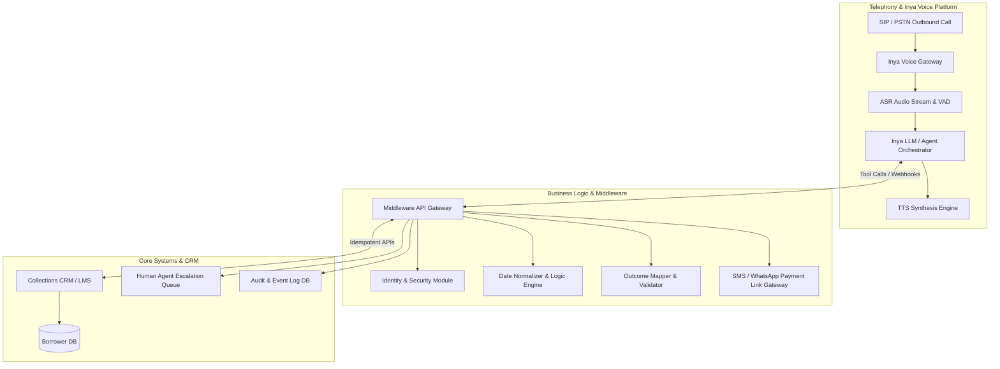
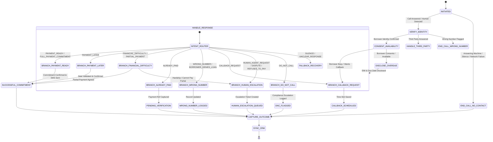

# Implementation Plan - Enterprise Voice Collections Bot on Inya (NBFC Early Collections)

Designing and building an enterprise-grade **Voice Collections Bot on the Inya agentic AI platform** for early-stage (1–30 DPD) loan collections at a mid-sized NBFC.

## User Review Required

> [!IMPORTANT]
> **Key Architecture & Platform Verification Assumptions:**
> 1. **Middleware Architecture**: All state validation (e.g., date relative-parsing like "next Tuesday", partial payment validation, DNC flagging) is executed through deterministic middleware APIs invoked via Inya Function Calling / Tools, ensuring LLM hallucination-free business logic.
> 2. **Compliance & Privacy**: Voice disclosure of loan details strictly occurs *after* positive identity verification (0-knowledge identity check) to comply with RBI Fair Practice Code and DPDP rules.
> 3. **Inya Platform Verification Points**: The design assumes standard enterprise voice agent capabilities (Dynamic Context Injection, Tool Calling, Structured Output Extraction, Webhooks, Barge-in/VAD). Specific platform verifications are highlighted in Section 4.

---

## 1. Proposed Enterprise System Architecture

The architecture decouples conversational NLU/Voice orchestration from deterministic business logic and CRM data synchronization:

### Architectural Layering & Decoupling Strategy
1. **Telephony & Audio Layer**: Inya Outbound Gateway handles SIP trunking, Voice Activity Detection (VAD), barge-in handling (interruption detection), dual-channel audio recording, and low-latency TTS/ASR stream processing.
2. **Dialogue & NLU Layer (Inya Agent)**: Inya system prompt manages conversational turns, empathy, short phone-optimized responses, and intent classification.
3. **Deterministic Middleware Layer**: Encapsulates business rules, date parsing (e.g., converting "day after tomorrow" to `YYYY-MM-DD`), threshold checks for partial payments (e.g., min 50% EMI), identity confirmation rules, and DNC registry logging.
4. **CRM & Integration Layer**: Asynchronous, idempotent REST APIs for pre-call data fetching, mid-call state events, and post-call structured outcome persistence.

---

## 2. Conversation State Machine

The conversation is modeled as a deterministic finite-state machine (FSM) where LLM dialogue stays bounded by strict state transitions:

### Fallback & Recovery State Protocol
- **Silence Handling**: 
  - Strike 1: "I didn't catch that. Could you please confirm if you can hear me?"
  - Strike 2: "The line seems quiet. I'm calling from NBFC regarding your EMI."
  - Strike 3: Log `NO_CONTACT_SILENCE` and gracefully disconnect.
- **Low Confidence / Unclear Response**:
  - Strike 1: Rephrase prompt clearly with explicit binary choice (e.g., "Would you like to pay today, or pick a date next week?").
  - Strike 2: Offer transfer to human agent.

---

## 3. Intent Taxonomy (20 Intent Specifications)

| Intent Name | Business Meaning | Example Utterances | Required Extracted Fields | Next State | Escalation Req | Final Outcome Code |
| :--- | :--- | :--- | :--- | :--- | :--- | :--- |
| `PAYMENT_READY` | Borrower willing to pay immediately | "Yes, I can pay right now", "Send me the link" | `payment_channel` | `CONFIRM_PAYMENT_DETAILS` | No | `PAYMENT_COMMITMENT_TODAY` |
| `PAYMENT_LATER` | Borrower commits to paying on a future date | "I will pay this Friday", "Give me 3 days" | `commitment_date`, `commitment_amount` | `ASK_EXPECTED_DATE` | No | `PAYMENT_COMMITMENT_FUTURE` |
| `FINANCIAL_DIFFICULTY` | Borrower facing temporary cash crunch | "I lost my job", "Salary delayed", "No money right now" | `reason`, `feasible_partial_amount` | `EXPLORE_PARTIAL_PAYMENT` | Conditional (If unable to pay partial) | `FINANCIAL_HARDSHIP` / `HUMAN_ESCALATION` |
| `CALLBACK_REQUEST` | Borrower busy or wants call later | "I am driving", "Call me after 5 PM", "Not a good time" | `callback_date`, `callback_time` | `CAPTURE_CALLBACK_SLOT` | No | `CALLBACK_SCHEDULED` |
| `WRONG_NUMBER` | Recipient claims not being the borrower | "You have the wrong number", "No Rahul lives here" | `is_wrong_number` (boolean) | `STOP_LOAN_DISCLOSURE` | No | `WRONG_NUMBER` |
| `BORROWER_DENIES_LOAN` | Borrower disowns loan account | "I never took any loan", "This is fake" | `denial_reason` | `LOG_DISPUTE` | Yes | `LOAN_DISOWNED_DISPUTE` |
| `ALREADY_PAID` | Borrower claims EMI is already paid | "I paid yesterday", "Money deducted from bank" | `payment_date`, `payment_mode`, `transaction_ref` | `CAPTURE_PAYMENT_DETAILS` | No | `CLAIMED_ALREADY_PAID` |
| `PARTIAL_PAYMENT` | Borrower offers partial EMI amount | "I can only pay ₹4,000 right now" | `partial_amount`, `remainder_date` | `CONFIRM_PARTIAL_AMOUNT` | No | `PARTIAL_PAYMENT_COMMITMENT` |
| `FULL_PAYMENT_COMMITMENT` | Express agreement to pay 100% EMI | "I will pay the full ₹8,500 on 15th" | `commitment_amount`, `commitment_date` | `CONFIRM_COMMITMENT` | No | `FULL_PAYMENT_COMMITMENT` |
| `REFUSES_TO_PAY` | Direct refusal to pay overdue EMI | "I am not paying", "Do whatever you want" | `refusal_reason` | `EVALUATE_REFUSAL` | Yes | `REFUSED_TO_PAY` |
| `NEEDS_PAYMENT_INFO` | Borrower asks for bank/UPI/link details | "How do I pay?", "What is the UPI ID?" | `requested_info_type` | `PROVIDE_PAYMENT_LINK` | No | `PAYMENT_INFO_PROVIDED` |
| `DISPUTE` | Dispute over EMI calculation/charges | "Interest rate is wrong", "Penalty was added unfairly" | `dispute_category`, `dispute_details` | `LOG_DISPUTE` | Yes | `ACCOUNT_DISPUTE_ESCALATED` |
| `HUMAN_AGENT_REQUEST` | Explicit request to talk to human | "Connect me to a agent", "Let me speak to a person" | `escalation_reason` | `TRANSFER_HUMAN` | Yes | `HUMAN_AGENT_REQUESTED` |
| `LANGUAGE_CHANGE` | Request to switch language | "Hindi me bolo", "Kannada mathadi" | `target_language` | `SWITCH_LANGUAGE_STATE` | No | `LANGUAGE_SWITCHED` |
| `DO_NOT_CALL` | Borrower requests deletion/no call | "Stop calling me", "Put me on DNC" | `dnc_request_type` | `LOG_DNC_PREFERENCE` | Yes (Compliance) | `DNC_REQUESTED` |
| `THIRD_PARTY_ANSWERED` | Spouse/Family member answered | "Rahul is out, I am his brother" | `third_party_relation`, `availability_time` | `HANDLE_THIRD_PARTY` | No | `THIRD_PARTY_CONTACT` |
| `BORROWER_UNAVAILABLE` | Borrower not available to take call | "He is sleeping", "She is in a meeting" | `availability_time` | `CAPTURE_CALLBACK_SLOT` | No | `BORROWER_UNAVAILABLE` |
| `SILENCE` | No audio received after turn | N/A | N/A | `FALLBACK_RECOVERY` | Conditional (Strike 3) | `NO_CONTACT_SILENCE` |
| `UNCLEAR_RESPONSE` | Low confidence ASR or mumbling | N/A | N/A | `FALLBACK_RECOVERY` | Conditional (Strike 2) | `UNCLEAR_AUDIO_ESCALATED` |
| `SYSTEM_ERROR` | Middleware/API failure | `error_code` | N/A | `GRACEFUL_DISCONNECT` | Yes | `SYSTEM_ERROR_ESCALATED` |

---

## 4. Inya Platform Verification Questions & Technical Assumptions

To ensure complete alignment with Inya's deployment engine, the following key items require platform confirmation:

1. **Pre-call Dynamic Variable Injection**:
   - *Assumption*: Inya allows passing borrower dynamic JSON payloads (`borrower_id`, `emi_amount`, `due_date`, `dpd`, `preferred_language`) via campaign launch REST APIs into the agent session context.
   - *Verification Needed*: Confirm the exact JSON context syntax inside system prompts (e.g., `{{borrower.emi_amount}}`).

2. **Real-time Tool / Action Calling**:
   - *Assumption*: Inya supports synchronous Webhook/Tool calling during active audio streaming (e.g., invoking `normalize_date` or `send_payment_link_sms` middleware API).
   - *Verification Needed*: Max execution timeout for real-time tool calls (target <500ms to avoid audio silence latency).

3. **Structured Outcome Extraction (Post-Call Schema)**:
   - *Assumption*: Inya supports JSON schema enforcement for post-call summary and structured extraction.
   - *Verification Needed*: Native JSON Schema enforcement vs. post-call webhook parsing.

4. **Interruption / Barge-in Control**:
   - *Assumption*: Inya allows configuring Voice Activity Detection (VAD) threshold and barge-in sensitivity so natural borrower speech interrupts bot prompts gracefully.
   - *Verification Needed*: VAD silence threshold settings (e.g., 600ms vs 1000ms).

5. **Telephony & Call Transfer Capabilities**:
   - *Assumption*: SIP REFER or PSTN warm transfer is available for `HUMAN_AGENT_REQUEST` state.
   - *Verification Needed*: SIP transfer config vs queue callback creation fallback.

---

## Next Stages Plan

- **Stage 1 (Current)**: Architecture, State Machine, Intent Taxonomy & Inya Verifications.
- **Stage 2**: Realistic Borrower Data Model (Pre-call, Mid-call, Post-call split).
- **Stage 3**: Production System Prompt Engine (Identity, Rules, Anti-hallucination, Tone).
- **Stage 4**: Voice Conversation Scripts & Natural Phone Dialogues.
- **Stage 5**: Objection Handling & Escalation Framework.
- **Stage 6**: Multilingual Architecture & Outcome JSON Schemas.
- **Stage 7**: Middleware REST API Specs & Integration Architecture.
- **Stage 8**: Edge Cases, QA Test Suite (20 Scenarios) & 6-Call Demo Scripts.
